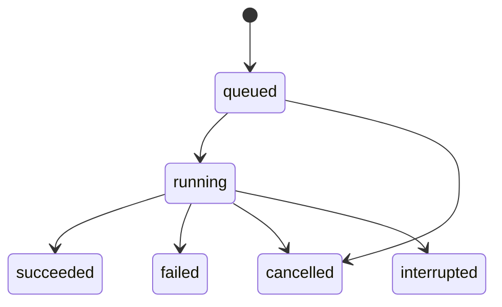

# Backend drift và lịch sử

Backend cung cấp API tạo lượt kiểm tra và trả 202 ngay sau khi lưu vào hàng đợi.
Một worker nền xử lý lần lượt bằng cùng engine với CLI. SQLite giữ hàng đợi,
trạng thái, báo cáo đã chuẩn hóa và lịch sử khi server khởi động lại.

Phiên bản đầu dành cho một máy và một nhóm người dùng chung token, bind
localhost. Chưa có RBAC theo người dùng, hàng đợi phân tán hoặc lịch quét tự động.

## Cài và chạy

```powershell
cd C:\work\infralens
uv sync --locked --group dev --extra backend --extra aws-trace

# Tạo token trong environment của terminal, không ghi vào registry/Git.
$env:INFRALENS_API_TOKEN = & .\.venv\Scripts\python.exe -c "import secrets; print(secrets.token_urlsafe(32))"
.\.venv\Scripts\python.exe -m infralens.backend `
  --config .\examples\backend\projects.json `
  --database .\reports\backend\history.sqlite3 `
  --port 8765
```

Swagger ở [localhost:8765/docs](http://127.0.0.1:8765/docs), OpenAPI ở
[localhost:8765/openapi.json](http://127.0.0.1:8765/openapi.json).
Các endpoint `/api/v1/*` cần header `Authorization: Bearer <token>`. Health,
Swagger và OpenAPI không yêu cầu token. Dừng server từ terminal bằng Ctrl+C.

## Dashboard trên trình duyệt

Mở [localhost:8765](http://127.0.0.1:8765/) sau khi chạy backend. Giao diện
được đóng gói cùng Python package, không cần Node, npm hoặc frontend server.
Trang HTML/CSS/JS và plan ví dụ là public; dữ liệu dự án/lịch sử/report vẫn
được bảo vệ bằng bearer token. Nội dung ví dụ hoàn toàn giả lập.

1. Nhập token đã đặt trong `INFRALENS_API_TOKEN` và bấm **Kết nối**. Với server
   demo của checkout này, copy token từ `reports/backend/demo-token.txt` trên máy
   vào ô API token; không đưa token vào URL hoặc commit lên Git.
2. Chọn dự án. Giao diện chỉ bật refresh/import/CloudTrail được registry cho phép.
   Project `drift-demo` chỉ import, nên không cần AWS để thử dashboard.
3. Chọn file Terraform show JSON (tối đa 1,9 MB trong giao diện), hoặc bấm
   **Nạp ví dụ 4 drift**, rồi **Tạo lượt kiểm tra**. Backend vẫn kiểm tra giới hạn
   request 2 MiB; file lớn hơn dùng CLI. File JSON lỗi không được echo vào lỗi UI.
4. Lịch sử tự cập nhật mỗi 3 giây, có filter status và phân trang 20 lượt.
   Bấm **Xem** để chọn lượt; các chỉ số phía trên luôn thuộc lượt đang chọn.
   **Làm mới** quay về trang gần nhất. Có thể hủy queued/running khi chưa kết thúc.
5. Báo cáo hiển thị saved state/observed, sensitive/unknown/absent/null, vị trí
   source hiện tại, tín hiệu review và event CloudTrail nếu đã tra cứu. Các ghi chú
   phạm vi từ engine nằm trong phần có thể mở rộng. Có thể lọc address và tải JSON
   đã chuẩn hóa. Chuỗi từ plan được hiển thị bằng text, không dựng HTML.
6. Comparison tự chọn lượt thành công trước cùng project/mode/scope. “Không còn
   được báo cáo” không chứng nhận hạ tầng đã sửa; import chưa xác minh freshness.

Token chỉ tồn tại trong bộ nhớ tab; không ghi localStorage/sessionStorage/cookie.
Ngắt kết nối xóa token, nội dung report và dừng polling; tải lại trang yêu cầu nhập
lại token. Raw plan được giữ trong bộ nhớ lúc chuẩn bị gửi, không lưu vào browser
storage. JSON tải xuống và dữ liệu chưa đánh dấu sensitive vẫn cần quản lý riêng tư.
Giao diện dùng tài nguyên cùng origin, CSP chặn script inline và nhúng iframe,
không dùng CDN/analytics. Phiên bản này dùng chung một token như API hiện tại.

Kiểm chứng dashboard: [biên bản 2026-10-23](verification/DASHBOARD_2026-10-23.md).

Token cần 24–256 ký tự chữ/số/gạch dưới/gạch ngang. Server không ghi token vào
lịch sử. Mỗi database chỉ có một server/worker owner, được bảo vệ bằng file lock;
không chạy nhiều Uvicorn worker trên cùng database. File lock được OS giải phóng
khi process kết thúc. API và worker dùng các SQLite connection riêng theo thao tác.

## Demo cục bộ trong checkout

Bản demo sử dụng project `drift-demo`, chỉ cho import plan giả lập, tắt refresh
và CloudTrail. Token của bản demo local nằm ở `reports/backend/demo-token.txt`
và được Git ignore. Khi server demo đang chạy, có thể thử ngay:

Khởi động nhanh dashboard từ repo (sau khi cài dependency):

```powershell
.\examples\backend\start_dashboard.ps1
```

Script tạo token local nếu chưa có, giữ token đã có, dùng registry/database demo,
in đường dẫn file token thay vì in token. Nếu terminal đã đặt `INFRALENS_API_TOKEN`,
script dùng token đó. Mở URL được in, nhập token, chọn **Nạp ví dụ 4 drift** rồi
**Tạo lượt kiểm tra**. Dừng bằng Ctrl+C. Có thể đổi port bằng `-Port 8766`.

Client kiểm tra API trực tiếp:

```powershell
.\.venv\Scripts\python.exe .\examples\backend\demo_client.py `
  --token-file .\reports\backend\demo-token.txt `
  --output .\reports\backend\demo.json
```

Client gửi một plan có bốn drift, thử lại cùng Idempotency-Key, gửi plan sạch,
đợi hai công việc hoàn tất và lấy comparison. Đây là dữ liệu giả lập, không gọi
Terraform/AWS. Bằng chứng lưu trong `reports/backend/demo.json`; schema đã xuất
ở `reports/backend/openapi.json`.

## Đăng ký dự án thật

File JSON là cấu hình do người vận hành quản lý. Path tương đối được tính từ
thư mục chứa file registry. Ví dụ:

```json
{
  "projects": [{
    "id": "sandbox",
    "name": "Terraform sandbox",
    "path": "C:/work/infra",
    "workspace": "default",
    "profile": "infralens-sandbox",
    "region": "ap-southeast-2",
    "var_files": ["dev.tfvars"],
    "data_dir": ".terraform",
    "allow_refresh": true,
    "allow_import": true,
    "allow_trace": true,
    "max_timeout": 300
  }]
}
```

Dùng checkout tin cậy, đã init Terraform và xác thực provider/backend. Backend
không tự clone/init/apply/destroy. Nó cố định workspace và TF_DATA_DIR theo
registry cho mỗi project, giữ nguyên cơ chế Terraform state lock. Biến và
credential chain được đọc từ môi trường server; không gửi AWS access key qua API.
Trace cần extra aws-trace và profile có quyền CloudTrail tương ứng.

HTTP caller chọn project ID, mode, trace/lookback, timeout và gate criteria. Request có
path, command, profile, output hoặc trường lạ bị từ chối. Nếu cấu hình dự án đổi
trước lúc thực thi, công việc cũ bị đánh dấu failed thay vì chạy nhầm scope.
Code/tfvars không được snapshot khi enqueue: worker đọc working tree hiện tại.

## API cho frontend

| Method và đường dẫn | Chức năng |
| --- | --- |
| GET /health | Trạng thái server/worker |
| GET /api/v1/projects | Dự án và mode được phép |
| POST /api/v1/projects/{project_id}/runs | Tạo công việc, trả 202 |
| GET /api/v1/projects/{project_id}/runs | Lịch sử, filter status và phân trang |
| GET /api/v1/runs/{run_id} | Trạng thái và metadata |
| GET /api/v1/runs/{run_id}/report | Báo cáo JSON cùng schema với CLI |
| POST /api/v1/runs/{run_id}/cancel | Hủy công việc đang chờ/đang chạy |
| GET /api/v1/runs/{run_id}/comparison | So sánh với lượt trước hoặc baseline_id chỉ định |

Request tạo lượt refresh:

```json
{"mode":"refresh","trace":false,"timeout":120}
```

Import dùng `{"mode":"import","plan":{...}}`, trong đó plan là đầu ra
Terraform show JSON, không phải báo cáo InfraLens. Raw plan chỉ được xử lý trong
memory để validate và che sensitive trước khi enqueue. Database lưu mô hình
chuẩn hóa; không lưu raw plan, variables hoặc outputs ngoài phạm vi báo cáo.

Trạng thái công việc:



`succeeded` là engine chạy thành công, kể cả khi `has_drift=true`. Frontend cần
đọc cả hai trường. `has_drift` là null trước khi có báo cáo. Lỗi trace làm job
failed với error_code cloudtrail_incomplete nhưng báo cáo drift vẫn được lưu.

Body phản hồi tạo công việc có `run` và `created`. Run chứa id, sequence,
project_id, mode, status, các mốc UTC, cancel_requested, has_report, has_drift,
error_code và request metadata. Poll GET run tới khi ra khỏi queued/running,
rồi lấy report khi has_report=true. Pending report trả 409, không có report
ở trạng thái kết thúc trả 404.

## Gate theo ưu tiên

Dashboard có mục **Gate · điều kiện chặn**: không đặt ngưỡng, ưu tiên cao,
từ trung bình trở lên, hoặc bất kỳ drift. Checkbox **Chặn cả khi chưa đủ ngữ
cảnh** hoạt động độc lập, kể cả khi không đặt ngưỡng. Các điều kiện kết hợp bằng
HOẶC. Mặc định tất cả đều tắt. Gate dùng chung policy và semantics với
[gate CLI](DRIFT_CI.md); không lọc finding hoặc thay đổi hạ tầng.

API nhận trường tùy chọn `gate`, áp dụng cho cả refresh và import:

```json
{
  "mode": "refresh",
  "gate": {
    "any_drift": false,
    "minimum_priority": "high",
    "unknown_priority": true
  }
}
```

`minimum_priority` chỉ nhận `"high"`, `"medium"` hoặc null, phân biệt hoa/thường.
Hai trường còn lại chỉ nhận boolean; trường lạ bị từ chối bằng 422 trước enqueue.
Bỏ `gate`, gửi null, object rỗng hoặc toàn giá trị tắt có cùng ý nghĩa và cùng
fingerprint với request trước khi tính năng này được thêm vào. Khi bật, criteria
được chuẩn hóa đủ ba trường trong `run.request.gate`; đổi criteria với cùng
Idempotency-Key trả 409. Request queued cũ vẫn thực thi khi khởi động lại.

Report chỉ thêm `gate` khi bật: policy, criteria, priority counts, danh sách
resource khớp, lý do và mã thoát tương đương CLI. Metadata/lịch sử có `run.gate`
là tóm tắt `{status, exit_code, matched_count}`; không copy giá trị thuộc tính
hoặc toàn bộ matched resources vào lịch sử. Khi chưa đánh giá hoặc không bật,
trường tóm tắt là null; đọc `run.request.gate` để phân biệt hai trường hợp.

| Thực thi | Gate | Ý nghĩa |
| --- | --- | --- |
| succeeded | passed / exit 0 | Không khớp điều kiện đã chọn; vẫn có thể có drift |
| succeeded | failed / exit 1 | Có resource khớp; dashboard ghi **Gate chặn** |
| failed / cloudtrail_incomplete | incomplete / exit 3 | Trace lỗi, giữ báo cáo nhưng chưa kết luận gate |
| failed, cancelled, interrupted không có report | null | Không được coi là gate đạt |

HTTP POST vẫn trả 202; gate exit code là dữ liệu trong report, không phải HTTP
status. Job `succeeded` có gate failed vẫn so sánh được và có thể làm baseline.
Khác gate criteria không làm thay đổi scope; comparison chỉ so finding/context.
Gate không bật giữ nguyên report cũ, không tự đánh giá lại lịch sử đã lưu.
Không cần migration SQLite; quyết định nằm cùng report và được đọc lại sau restart.

Demo API với server cục bộ đang chạy:

```powershell
.\.venv\Scripts\python.exe .\examples\backend\demo_client.py `
  --token-file .\reports\backend\demo-token.txt `
  --gate-priority high --gate-unknown `
  --output .\reports\backend\gate-demo.json
```

Demo kiểm tra retry idempotency, report đủ 4 resource với 3 resource khớp gate,
lượt sạch gate passed và comparison từ lượt bị chặn. Có thêm `--gate-any` và
`--gate-priority medium`; không truyền cờ giữ hành vi demo cũ.

Kiểm chứng: [Backend/dashboard gate — 2026-10-23](verification/BACKEND_GATE_2026-10-23.md).

Ví dụ PowerShell dùng server demo đang chạy:

```powershell
$token = (Get-Content .\reports\backend\demo-token.txt -Raw).Trim()
$headers = @{ Authorization = "Bearer $token" }
$history = Invoke-RestMethod http://127.0.0.1:8765/api/v1/projects/drift-demo/runs -Headers $headers
$history.items | Select-Object id, status, has_drift, created_at
```

Frontend ở origin khác có thể cấu hình `--cors-origin http://localhost:5173`.
Trình duyệt gửi Authorization header; CORS chỉ cho origin đã cấu hình, method
GET/POST và các header cần thiết. Swagger có nút Authorize để nhập token.

## Phân trang, chống lặp và giới hạn

- Lịch sử dùng `limit` 1–100, mặc định 20. Nếu `next_before` khác null, truyền
  `?before=<next_before>` để lấy trang kế. Filter status nhận các trạng thái ở sơ đồ.
- Header Idempotency-Key: 1–128 ký tự chữ/số/gạch dưới/gạch ngang, phạm vi theo
  project. Cùng key và request đã chuẩn hóa trả cùng run, created=false; khác
  request trả 409. Token/API credentials không tham gia khóa này.
- Mặc định tối đa 100 lượt queued/running; vượt giới hạn trả 429. Retry cùng
  Idempotency-Key vẫn nhận được lượt cũ khi hàng đợi đầy.
- Body thực nhận giới hạn 2 MiB, gồm cả request chunked. Lookback 1–90 ngày,
  timeout tối đa theo project và trần 600 giây. Các timeout engine vẫn áp dụng
  theo từng phase; đây không phải deadline tổng của toàn công việc.

Hủy là hợp tác: Terraform process được dọn cùng tiến trình con; source parsing
và SDK chuyển phase mới sau checkpoint. Một SDK request đang chạy có thể cần
chờ connect/read timeout trước khi hủy hoàn tất. Shutdown ngừng claim việc mới,
ngắt việc đang chạy rồi giữ queued để lần khởi động sau tiếp tục. Sau hard crash,
running thành interrupted/cancelled; không tự retry, không force-unlock Terraform.

## So sánh lịch sử

Mặc định lấy lượt succeeded trước đó cùng project, mode và scope cấu hình
(path/workspace/profile/region/var-file paths/data-dir). Có thể chọn baseline_id;
khác scope/mode/project, baseline mới hơn hoặc chưa thành công trả 409.
Không có baseline hợp lệ trả status baseline_missing.

Các nhãn là new, no_longer_reported, changed, unchanged, indeterminate. Chúng
so finding resource/action/path/value; bỏ qua checked_at, source location,
actor CloudTrail và priority để tránh nhiễu metadata. Trường sensitive/unknown
không bị gọi là unchanged khi không đủ dữ liệu để xác nhận. Comparison không
chép giá trị cũ/mới, chỉ trả address, status, changed_paths và số lượng.

Với Security Group rule tách riêng, comparison còn xét `network_context` đã
chuẩn hóa. Cùng đổi port nhưng CIDR/protocol/group nền khác nhau là finding đã
thay đổi. Nếu báo cáo cũ thiếu context hoặc context bị sensitive/unknown, không
kết luận unchanged khi chưa đủ dữ liệu. Context vẫn không được chép vào comparison.
Demo registry có thêm project `network-rules-demo` với [6 tình huống](../examples/network-rules/README.md).

No_longer_reported chỉ nói finding không còn trong báo cáo; không chứng nhận
hạ tầng đã được sửa. Terraform state, cấu hình hoặc độ phủ có thể thay đổi.
Import vẫn có freshness/coverage chưa xác minh. Scope key không xác minh account
AWS nếu credentials phía server đổi mà registry không đổi; cần giữ cấu hình
account/workspace nhất quán khi đọc lịch sử.

## Lưu trữ và lỗi

SQLite dùng WAL và transaction để enqueue/claim/cancel. Payload chuẩn hóa tạm
được xóa sau khi hoàn tất; báo cáo/metadata được giữ, chưa có retention tự động.
Các giá trị chưa được Terraform đánh dấu sensitive vẫn có thể nằm trong report,
giống CLI. Database/report cần được quản lý như dữ liệu riêng tư của dự án.

Lỗi HTTP/worker được trả bằng code có kiểm soát, không echo raw exception hoặc
request body. Báo cáo có Cache-Control no-store. API không lưu token vào DB,
không có endpoint đọc raw state hoặc credential. DB không được đặt trùng input
Terraform hoặc metadata, kể cả qua hardlink.

## Kiểm chứng

```powershell
.\.venv\Scripts\python.exe -m pytest -q tests/test_backend.py tests/test_process.py
```

[Biên bản kiểm chứng](verification/BACKEND_2026-10-22.md).

Tham khảo: [FastAPI lifespan](https://fastapi.tiangolo.com/advanced/events/),
[FastAPI security](https://fastapi.tiangolo.com/tutorial/security/),
[SQLite thread model](https://www.sqlite.org/threadsafe.html).
